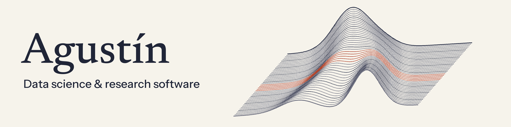

I work on classification problems where labels are scarce and the hard cases are worth a closer look. I build tools that let me follow an example through a model, recover a notebook after a failure, or find an experiment I left in a different terminal.

**Try Semantic Instruments.** Pick a point in the Space Explorer, inspect its nearest neighbors, then follow it from its embedding to the model’s output. [Open the interactive lab →](https://essencesentry.github.io/semantic-instruments/)

### From my workbench

**ax + AX Widget** · My command-line workbench for Claude and Codex. I can search earlier sessions, detach a long-running command, and reattach to it later. Its Mac companion shows running work and opens a conversation where I left off. [Explore ax →](https://github.com/EssenceSentry/agent-skills/tree/ax-workbench)

**Aside** · A Mac meeting companion that transcribes speech locally. I can correct a name in the transcript, find the original passage, and return to what was actually said.

**Atelier** · The starter kit I use for review stations, live monitors, and interactive labs. Aside’s interface and my Probability Lab both started here. The latter lets me follow a single draw through a probabilistic model.

**Runwatch** · A notebook runner for experiments that take a while. When a cell fails, I can inspect the live state, repair the code, and resume from the failure. [See how recovery works →](https://github.com/EssenceSentry/runwatch#failure-and-recovery)
